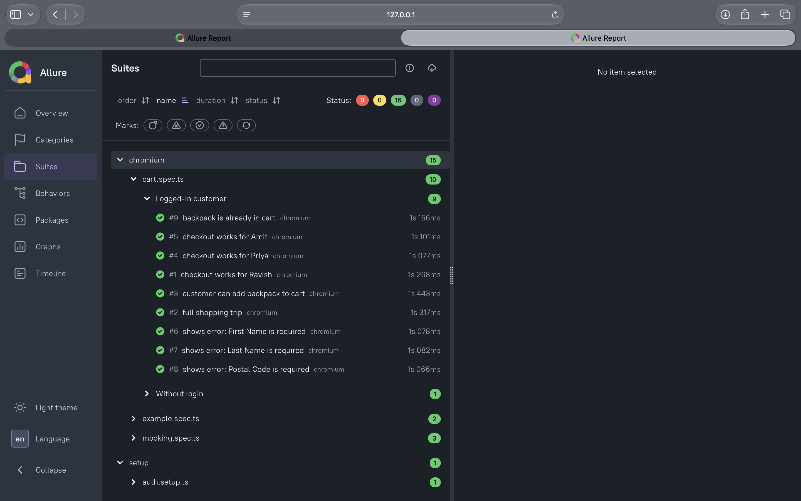

# Playwright + TypeScript Test Automation Framework


End-to-end UI and API test automation framework for [Sauce Demo](https://www.saucedemo.com) and [Restful Booker API](https://restful-booker.herokuapp.com), built with Playwright and TypeScript.

## Features
- **Page Object Model** with custom Playwright fixtures (no setup code in tests)
- **Login once, reuse everywhere** via a setup project and `storageState`
- **Data-driven tests** from JSON (positive and negative checkout scenarios)
- **API testing**: full CRUD lifecycle, token auth, status-code and negative tests
- **Network mocking**: fake, modified and failing API responses
- **Known-bug tracking** with `test.fail` (alerts automatically when a bug is fixed)
- **Tags** for smoke vs full regression
- **Cross-browser**: Chromium, Firefox, WebKit
- **Reporting**: Playwright HTML report + Allure, with screenshot, video and trace on failure


## Tech stack
Playwright · TypeScript · Node.js · dotenv · Allure

## Project structure
```
pages/        Page objects (locators + actions, no assertions)
fixtures/     Custom fixtures that provide ready page objects and states
tests/        UI tests, auth setup, mocking tests
tests/api/    API tests (Restful Booker)
test-data/    JSON test data
utils/        Environment helper (fails fast on missing variables)
```

## Getting started
```bash
git clone https://github.com/Ravishbond/playwright-saucedemo-framework.git
cd playwright-saucedemo-framework
npm install
npx playwright install
cp .env.example .env    # then fill in the values
```

## Running tests
| Command | What it runs |
|---|---|
| `npm test` | Full suite, all browsers |
| `npm run test:smoke` | Smoke tests only (`@smoke`) |
| `npm run test:api` | API tests only |
| `npm run test:ui` | Playwright UI mode |
| `npm run report:allure` | Generate and open the Allure report |

## Bugs found during testing
| ID | Area | Finding |
|---|---|---|
| BUG-101 | Booking API | Accepts a negative `totalprice` (expected 400) |
| BUG-102 | Web UI | Shows infinite "Loading..." when the API returns 500, with no error or retry |
| Note | Booking API | DELETE returns 201 instead of 200/204; unauthenticated delete returns 403 instead of 401 |

## Author
**Ravish**, Automation Architect (web, mobile and API test automation)